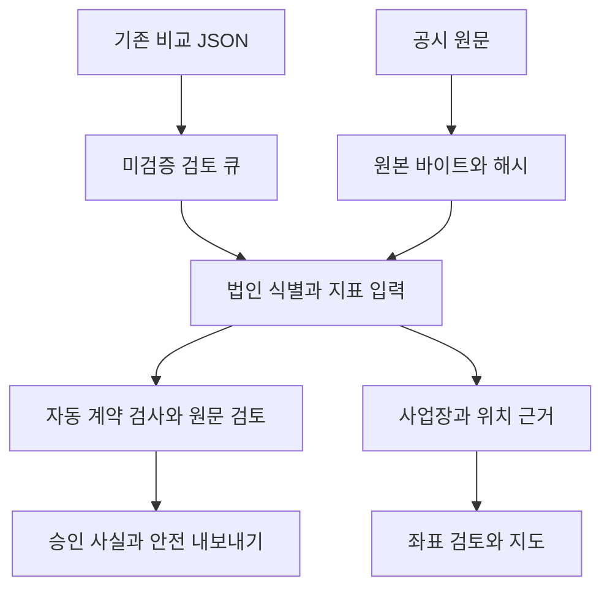

# 통합 리서치 콘솔 구현 및 검증 기록

구현/원문 대조: 2026-11-14. 인계 정리: 2026-11-15 (KST).

## 현재 결과와 범위

기존 사이트를 별도로 유지하고 신규 저장소에 로컬 콘솔을 추가했다. 기존 공개 사이트, main, 운영 배포 경로를 변경하지 않는다. 운영 시스템 완성이나 모든 기업 재무의 전수 검증 완료를 의미하지 않는다.

| 영역 | 구현 | 남은 데이터/운영 작업 |
|---|---|---|
| 기업 마스터 | 189개 기존 마스터 보존, 필터·검색·상세·분류 근거·법인 관계 입력 | 과거 186/202 모집단 원본과 교차 대조, 해외 법인 식별·중복 연결 |
| 기존 비교 자료 | 4개 파일 원본 해시·JSON 포인터 보존, 857항목 큐, 명시적 법인 연결 | 각 원문 증빙을 지표별 사실로 연결 |
| 재무 | 원문·기간·단위 검사, 승인/반려/철회, 정정 버전, 안전 내보내기 | 기존 수치 원문 전수 대조, 국가별 수집기 추가 |
| 실적 비교 | 2023–25 6지표 완비·동일 기준 패널, 원통화 및 YoY | 검증된 FX를 통한 국가 간 합계는 미구현 |
| 지도 | 법인/사업장 분리, 근거 문서, 좌표 정밀도·승인·철회, 세계/한국 지도 | 실제 사업장 주소/좌표 검증; 현재 승인 0건, 군집화·행정구역 통계 미구현 |
| 운영 | 로컬 세션 키, Origin/Host 검사, JSON API, 이력 보존 | 다중 사용자 인증·권한, 운영 백업 자동화, 배포는 별도 작업 |

## 기존 비교 자료의 정확한 재사용 범위

[원본 비교 화면](https://captaincatb-web.github.io/Sangsaengnews/pair-compare.html)의 소스 기준 커밋은 `2884b108bec8fd321ea120513934019db72a7d8f`이다.

| 파일 | 반입 항목 | 처리 |
|---|---:|---|
| [pair-roster.json](https://github.com/captaincatb-web/Sangsaengnews/blob/2884b108bec8fd321ea120513934019db72a7d8f/site/data/pair-roster.json) | 86 | 국내43 + 글로벌43의 화면 명단·본사 연결 정보 |
| [growth-companies.json](https://github.com/captaincatb-web/Sangsaengnews/blob/2884b108bec8fd321ea120513934019db72a7d8f/site/data/growth-companies.json) | 708 | blend308 + cons_listed157 + sep_kr243, 모드 중복 보존 |
| [pair-extra.json](https://github.com/captaincatb-web/Sangsaengnews/blob/2884b108bec8fd321ea120513934019db72a7d8f/site/data/pair-extra.json) | 54 | 기존 추가 재무와 출처 메모 보존 |
| [pair-parent-consolidated.json](https://github.com/captaincatb-web/Sangsaengnews/blob/2884b108bec8fd321ea120513934019db72a7d8f/site/data/pair-parent-consolidated.json) | 9 | 본사 원통화·기간·검증 문구·공시 링크 보존 |
| 합계 | 857 | 86 + 708 + 54 + 9. 고유 법인 수 아님 |

원본은 로컬 SQLite `legacy_source.body`에 저장하고, 파생 행은 `legacy_observation`에 저장한다. 기존 승인 문구는 `original`에 보존하되 새 검증 상태는 `legacy_unverified`이다. 과거 자료가 잘못됐다는 판정이 아니라 새 지표별 원문·표 위치 계약을 아직 통과하지 않았다는 의미다.

원화 환산 행의 `KRW / 억 원`은 **기존 표시 통화·단위**다. 기업 원문 통화로 해석하거나 임의 환율로 역산하지 않는다. 9개월 결산, null, 모회사 참고값, 복수 모드는 원형을 보존한다. 이름만으로 기존 기업 마스터에 합치지 않는다. 운영자가 `legacy_bind`로 법인 식별 근거를 기록한다.

공개 스냅샷에는 이 큐의 기업명·유형·상태·원본 파일 포인터만 포함하며 미검증 숫자는 없다. 원본 JSON과 원문 PDF는 저장소에 커밋하지 않는다.

## ASML 검증 사례

공식 자료: [ASML Annual Report 2025, US GAAP PDF](https://ourbrand.asml.com/m/71076aaad607de4d/original/asml-2025-annual-report-based-on-us-gaap.pdf), 물리/인쇄 276쪽, `Consolidated statements of operations`.

| 지표, EUR millions | 2023 | 2024 | 2025 |
|---|---:|---:|---:|
| Total net sales | 27,558.5 | 28,262.9 | 32,667.3 |
| Income from operations | 9,042.3 | 9,022.6 | 11,301.4 |

각 회계기간은 1월1일~12월31일, 연결, US-GAAP. 원통화 금액 = 원문 값 × 1,000,000. 예: 2025 매출 32,667.3 × 1,000,000 = 32,667,300,000 EUR. YoY = (당년/전년 − 1) × 100, 소수 둘째 자리 표시. 전기 값이 0 이하이면 백분율을 표시하지 않는다.

원문을 페이지 이미지로 렌더링하여 두 행과 3개 연도 열을 직접 대조했고, 동일 PDF 해시·텍스트 행을 재검사하는 어댑터를 추가했다. 상세 계약·SHA-256은 `data/public/asml-source-contract.json`에 있다. 이 사례의 기술적 원문 확인은 생산 사이트 공개 승인과 별개다.

## 아키텍처와 데이터 경계

`ResearchStore`의 기존 스키마 버전1을 유지하며 콘솔 보조 테이블을 추가한다. 보조 테이블 초기화는 재실행 가능하고 UPDATE/DELETE 트리거를 건다. 추후 스키마 구조 변경 시 명시적 migration이 필요하다. 복구는 종료된 DB 파일 백업을 별도 경로에 복사하고 해당 경로로 실행한다. 현재 자동 백업/복구 테스트는 포함하지 않는다.

- 승인된 금융 사실만 내보낼 수 있고, 최신 철회 또는 정정 후에는 이전 사실로 새 내보내기를 만들 수 없다.
- 기존 릴리스 원본은 보존한다. 내보내기 wrapper의 공개 기업 ID는 내부 UUID의 해시이며 사업자번호가 아니다.
- 원문 호스트 allowlist는 운영자가 검토한 정책이다. URL 문자열/문서 해시만으로 진위를 자동 인증하지 않는다.
- `--preview`는 읽기 전용 스냅샷이고 DB에 접근하지 않는다. 로컬 API는 loopback/세션키/Origin/Host를 검사한다.
- HTML 원문은 다운로드 바이트로만 제공하며 앱 원점에서 실행하지 않는다. CSP는 외부 스크립트·inline script를 허용하지 않는다.
- 지도는 Natural Earth 1:110m land([원본](https://naciscdn.org/naturalearth/110m/physical/ne_110m_land.zip), public domain)를 경위도 SVG로 변환했다. 국가 경계·상세 지도·지오코딩 결과가 아니다.

## 검증과 승인 전 조건

자동 테스트 72건이 통과했다. 기존 재무 검증·DB 테스트에 콘솔 API/반입/비교 및 모회사 재무의 자회사 대체 차단 테스트를 추가했다. 실제 금융 수치를 테스트용 합성값으로 대체해 공개하지 않는다. 합성 문서는 오프라인 테스트에만 존재한다.

브라우저에서 기업 검색, ASML 상세·3개년 근거, 기존 자료 TANAKA 검색, 원통화/원화 자료 구분, 지도 세계/한국 전환과 미확인 좌표 빈 상태를 확인했다. 데스크톱 검증이며 모바일 실기기 검증은 아직 수행하지 않았다. 원문 등록·승인·철회·내보내기 쓰기 동작은 로컬 HTTP/서비스 통합 테스트로 검사한다.

병합 전에 각 PR CI와 연결 순서를 확인한다. PR #1(계약) → #2(DB) → 콘솔 PR 순서다. 현재 배포 workflow는 없으며 병합해도 기존 Sangsaengnews가 자동 교체되지 않는다. 운영 연결·배포는 사용자 승인 후 별도 변경으로 진행한다.
